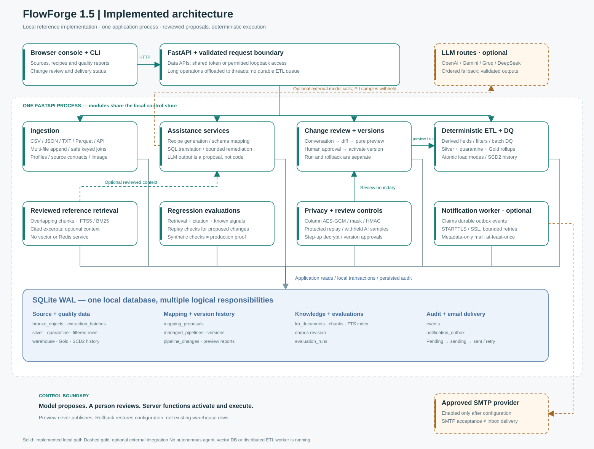
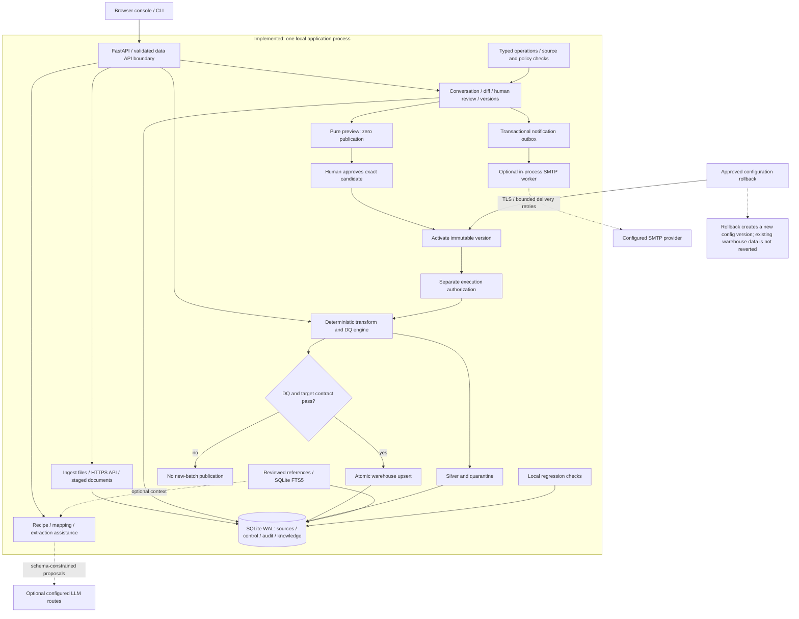
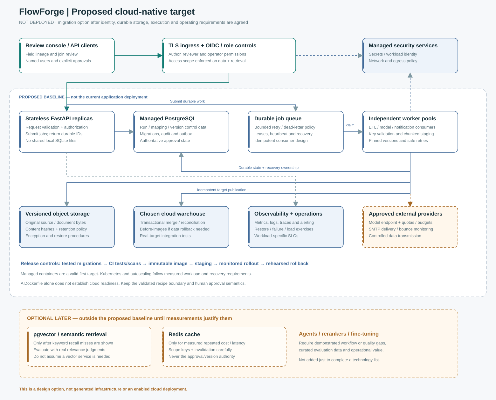
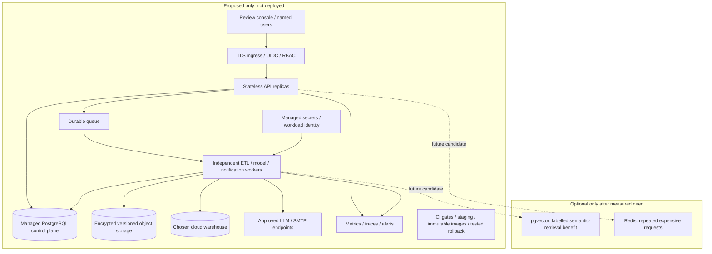

# Architecture — FlowForge 1.5.0

Updated 3 November 2026. Start with [SYSTEM_GUIDE.md](SYSTEM_GUIDE.md) for the consolidated implementation and operating guide.

## Implemented architecture

One FastAPI process hosts the review API, deterministic ETL functions and optional SMTP worker. SQLite stores raw/protected source snapshots, Gold rollups, SCD2 history, source profiles/contracts and, quality results, warehouse rows, immutable pipeline versions, proposals, audit events, reviewed reference chunks and the notification outbox. Optional model calls produce proposals, not executable authority.

## Proposed cloud-native target — not deployed

The cloud target requires identity/authorization, managed control/object storage, queue-backed workers, production integration tests, observability and controlled releases. Vector search and Redis remain optional candidates, not baseline dependencies. See [PRODUCTION_READINESS.md](PRODUCTION_READINESS.md).

## Design boundaries

- Preview never publishes. Activation, execution and rollback are distinct reviewed actions.
- Configuration rollback does not reverse warehouse data or cancel in-flight work.
- Shared-token review is not named-user SSO or separation of duties.
- SMTP delivery is at-least-once, advisory and disabled until configured.
- Retrieved knowledge supplies optional reference context; current search is SQLite FTS5/BM25, not vector search.
- The existing Docker packaging is not a deployed cloud-native platform.

The [browser architecture view](diagrams/architecture.html), SVGs and `.mmd` files can be shared or edited without external scripts or internet access.
