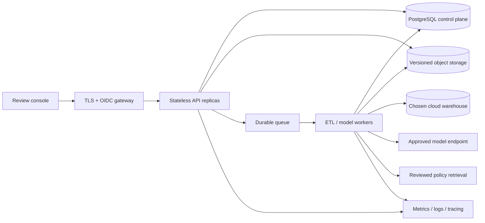

# Production readiness and feasible next steps

> Release 1.5 current behavior: see [MEDALLION_ETL.md](MEDALLION_ETL.md), [DESTINATIONS.md](DESTINATIONS.md), [PII_HANDLING.md](PII_HANDLING.md) and [ENGINEERING_COVERAGE.md](ENGINEERING_COVERAGE.md). These supersede older UI/format descriptions below. Cloud selections export plans only; column protection requires externally configured keys.

Assessment: **local reference implementation, not production-ready**. A cloud-native evolution is feasible, but it is not a configuration switch. No cloud resources were provisioned, no model was fine-tuned, and no autoscaling policy was deployed.

## Architecture decisions based on this application's needs

| Topic | Decision now | Reason and promotion trigger |
|---|---|---|
| Grounded policy/runbook retrieval | Implement as opt-in context for schema mapping and local cited lookup | Mapping needs organization-specific rules that source names/samples cannot supply. Store reviewed references with immutable chunk IDs, source hashes and character offsets. |
| Vector database / neural embeddings / hybrid search | Defer | The current small runbook corpus is retrievable with SQLite FTS5/BM25. No measured semantic-retrieval advantage has been demonstrated. Reconsider when labelled synonym, multilingual or larger-corpus queries show keyword recall misses. |
| Reranker | Defer | Adds model latency/cost and its own evaluation requirements. First collect relevance judgments and show an improvement over BM25. |
| LangGraph / autonomous agents / general tool calling | Defer | Current mapping is a fixed profile → propose → human review → execute workflow. The existing validated functions and persisted proposals fit it. Autonomous routing and a second checkpoint system would add failure modes without a demonstrated requirement. |
| Durable queue | Required before cloud production, not added as a demonstration agent | Long model/ETL calls should move off HTTP requests when actual workload and deployment are chosen. Use durable jobs, leases, bounded retries, idempotent publication and explicit recovery ownership. |
| Evaluations and output validation | Implement focused regression checks now | Test retrieval relevance, evidence references, hallucinated citation rejection, known injection signals and abstention. Keep existing schema, approval, idempotency and quality tests. |
| Prompt-injection defense | Keep execution allowlists; add conservative input/evidence checks | Pattern detection is only a warning/rejection heuristic. Neither it nor valid citations proves safe or correct model reasoning. Retrieved content never grants tool permissions. |
| Async API | Use async request handling with blocking retrieval/model calls offloaded to worker threads | Preserves responsiveness locally. Thread offloading does not provide a durable queue or distributed execution. |
| Response caching | Defer | The local keyword lookup is cheap. Caching introduces invalidation, access-scope and stale-policy risks. Add it only if measured latency/cost warrants it. |
| Fine-tuning | Defer | There is no sufficiently curated training set or verified model error taxonomy. Start with reviewed mappings, held-out cases, prompt improvements and retrieval. Train only if recurring errors remain and held-out accuracy improves enough to justify model operations. |
| Cloud autoscaling | Defer implementation until storage and workers are redesigned | Multiple current API processes can interfere with startup run recovery, and local SQLite/files are not a shared multi-replica control plane. An HPA template would be unsafe as-is. |
| Docker / CI/CD | Existing Docker packaging is useful; cloud release pipeline design remains pending | A Dockerfile is not production readiness. Establish CI gates, immutable images, staging checks, security scans, release approvals and rollback on the selected platform. |

The initial LangGraph/vector/training scaffold was removed after this fit assessment. Those technologies are not runtime dependencies of the delivered implementation.

## What exists today

- FastAPI service, local review console, validated recipes and deterministic execution.
- Immutable parsed source snapshots with content hashes, lineage, run history and application audit events.
- Row-quality checks, quarantine, batch gates, target schema compatibility and atomic local publication.
- Run idempotency, reviewed semantic mapping, source/schema-bound approval and bounded transformation remediation.
- Managed pipeline versions, typed conversational patches, no-publish replay, explicit human approval and configuration-only rollback.
- Transactional metadata-only notification outbox with optional SMTP delivery and visible retries.
- Shared development token, cross-origin mutation checks, restricted API ingestion and server-side credentials.
- Optional local keyword retrieval over reviewed references, exact evidence-reference validation and a small repeatable regression dataset.

These are useful components, but do not provide multi-user authorization, tenant isolation, tamper-proof auditing, complete PII handling, a durable worker service or production operating evidence. Live Groq discovery and mapping were verified on synthetic data. Production inference accuracy, quotas and operating behavior require representative workload validation.

## Concrete production blockers

1. **Identity and access:** replace the shared token with OIDC/SSO, API authorization and named roles for source access, policy review, mapping approval and execution. Enforce access scope in retrieval as well as ingestion. Add tenant isolation only if multi-tenancy is required.
2. **Durable storage and migrations:** move the control plane to PostgreSQL with versioned, tested migrations. Keep source bytes and documents in encrypted/versioned object storage; current bronze stores parsed rows, not all original bytes.
3. **Execution model:** separate stateless APIs from durable job workers. Introduce job leases, heartbeat, bounded retries, cancellation, graceful drain and idempotent target writes. Replace startup's blanket interruption of running jobs with lease-aware recovery.
4. **Secrets and network:** use managed secrets/workload identity, TLS, controlled ingress/egress, request limits and data-classification rules. Keep sensitive samples out of external requests unless approved.
5. **Operations:** instrument run state, provider errors, model usage, queue depth, quality rejection, latency and publication lag. Establish workload-specific SLOs, alerts, retention and incident ownership.
6. **Recovery:** test backups and restores, warehouse rollback/reconciliation and object retention. Audit who approved which policy/mapping and keep durable external audit records when required.
7. **Release evidence:** run functional, permission, integration, load, failure-injection and model-quality tests in staging. Verify provider limits and real destination transaction behavior. Dependency and image scans must be actionable gates.

## Feasible cloud-native target

This design can map to managed containers or Kubernetes on the chosen cloud. Select the smallest managed platform that meets security, scale and recovery needs; Kubernetes is not a prerequisite. Keep the current recipe/model-validation boundary and approval semantics. Add a vector service only when the retrieval benchmark requires it.

## Migration sequence and release gates

| Phase | Deliverable | Exit evidence |
|---|---|---|
| 1: Define requirements | Single/multi-tenant decision, data classification, workload, warehouse, cloud, availability and recovery objectives | Agreed requirements and threat model |
| 2: Secure pilot | OIDC/RBAC, PostgreSQL, object storage, migrations, managed secrets | Permission tests, migration rehearsal and restore test |
| 3: Reliable execution | Queue-backed workers, lease recovery, target connector, idempotent replay | Crash/retry/failover tests, warehouse reconciliation and realistic load results |
| 4: Controlled release | CI tests/scans, immutable image digest, staging, monitored rollout and prior-image rollback | Successful staging run and rollback rehearsal |
| 5: Scale when measured | Worker scaling based on queue lag; API scaling based on workload | Benchmarked limits and no duplicate/partial publication under concurrency |
| 6: Model optimization when justified | Optional semantic retrieval/reranking or fine-tuning | Held-out quality gain with latency, cost and failure behavior reported |

Do not choose a schedule, cloud service, spend budget or numerical SLO without the deployment requirements. This report is the migration option; it does not claim the target architecture is deployed.

## Evaluation limits

The bundled checks use three short synthetic references, three retrieval questions, known injection strings and one unrelated question. Passing them verifies wiring and prevents specific regressions. It does not measure model accuracy on real supplier schemas, defeat arbitrary prompt injection, establish semantic entailment or demonstrate that RAG improves mapping. Optional retrieval stays off by default. A blinded real-world mapping comparison with and without reference context is needed before making it the default.
