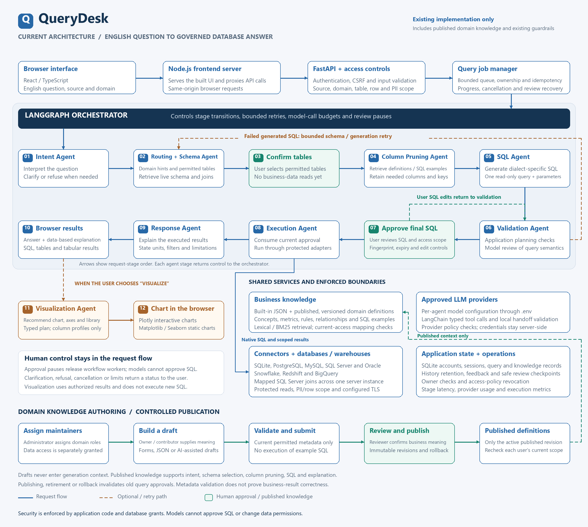

# Current architecture and request flow

This diagram describes the implemented QueryDesk application, including the domain knowledge workspace. It does not include proposed vector search, MCP integrations, analytical memory, a Feedback Agent or parallel retrieval.



[Scalable SVG](docs/architecture/querydesk-current.svg) · [Editable Mermaid source](docs/architecture/querydesk-current.mmd)

## Read the diagram

- **Blue arrows:** the main query request and response path. The lower agent row proceeds from right to left; numbered steps establish the order.
- **Green cards:** human review/approval gates. Knowledge publication is separate from permission to execute SQL.
- **Dashed lines:** optional visualization, bounded correction paths or publication of permitted context.
- The LangGraph orchestrator controls transitions between stages. Agent-to-agent arrows show processing order, not independent agents invoking arbitrary peers.

## Query request flow

| Step | Component | Responsibility |
| --- | --- | --- |
| Entry | React browser → Node.js server → FastAPI | Accept the question and source/domain preference; authenticate the user, check CSRF and validate inputs. |
| Admission | Query job manager | Apply ownership, idempotency, bounded queue/capacity, progress and cancellation controls. |
| 1 | Intent Agent | Interpret the business question using permitted definitions; clarify ambiguity or refuse unsupported tasks. |
| 2 | Domain routing and Schema Agent | Use domain hints and current authorized metadata to select tables and relationships. Domains guide relevance; they do not replace permissions. |
| 3 | User table confirmation | Let the user confirm/change the proposed tables within the permitted scope. |
| 4 | Knowledge retrieval and Column Pruning Agent | Retrieve relevant approved SQL examples and definitions; retain required measure, date, filter, grouping and join columns. |
| 5 | SQL Agent | Generate one read-only statement in the selected connector dialect with separate parameters. |
| 6 | Validation Agent | Combine protected application planning with model review. Neither alone proves business correctness. |
| 7 | User final SQL approval | Bind approval to the current SQL, parameters, schema/security projection, limits and deadline. Edits return to validation. |
| 8 | Execution Agent | Consume valid approval and execute through protected source adapters. Models cannot grant themselves authority. |
| 9–10 | Response Agent → browser | Explain only authorized executed results, assumptions, units and limitations; show SQL and a native results table. |
| 11–12 | Optional Visualization Agent → browser chart | On user request, recommend a bounded typed chart using column profiles. Render with approved Python adapters without rerunning SQL. |

The orchestrator can return failed generated SQL to schema/generation planning within its attempt budget. A repaired query needs fresh validation and SQL approval. Invalid manual edits stop for renewed user review. Clarification, refusal, cancellation, policy failures and exhausted limits return a status without bypassing approvals. Uncertain warehouse executions are not automatically replayed.

## Domain knowledge authoring flow

1. An administrator creates/reviews a domain, grants intended source/domain data access and assigns separate knowledge-maintenance roles.
2. An owner/contributor creates a concept, metric, accepted relationship, reporting rule or SQL example through forms, validated JSON preview or optional AI-assisted suggestions.
3. The app validates mapped objects against current permitted metadata. Example SQL is planned without executing business-data reads. Suggested business meanings/cardinalities remain assumptions until reviewed.
4. The contributor submits an immutable draft revision. Draft and submitted versions are excluded from query-generation context.
5. A reviewer confirms business meaning and representative questions, records review evidence/limitations and explicitly publishes. An administrator can fill both author/reviewer roles for small teams; an ordinary reviewer cannot publish their own authored entry.
6. The active published version is rechecked against each request's current domain/table/column scope before use. Inaccessible or stale mappings are omitted in full. Publication, retirement or rollback atomically advances the security epoch and invalidates affected old query authorization contexts; waiting jobs are cancelled through the existing manager.

See [Domain knowledge workspace](DOMAIN_KNOWLEDGE.md) for exact screen names, role capabilities, imports, revision history, limits and troubleshooting.

## Existing supporting components

| Component | Implementation boundary |
| --- | --- |
| Business context | Built-in source-specific JSON catalogs/examples plus published knowledge in the application records database. Keyword/alias matching, relationship context and BM25-style SQL-example retrieval; no vector database. |
| Model integration | Per-agent `.env` model configuration, LangChain typed function calls, local contract validation and approved provider/data-handling policy. API keys are not prompt content. The orchestrator itself is application logic. |
| Database adapters | SQLite, PostgreSQL, MySQL, SQL Server, Oracle, Snowflake, Redshift and BigQuery. Mapped SQL Server supports registered cross-database joins on one instance. Connector implementation is not evidence of live operator-specific warehouse verification. |
| Access enforcement | Current source/domain/table/column scope, configurable row restrictions, PII protections, read-only query checks, approval fingerprints, timeouts, result limits and cancellation. Warehouse grants remain necessary. |
| Persistence | Local SQLite application records contain accounts/sessions, query lifecycle/history, feedback, review checkpoints, domains and `dk_*` knowledge tables. Query retention and owner deletion remain separate from durable knowledge configuration. |
| Operations | Process-local queue and latency/provider/warehouse metrics, token reporting and configurable concurrency/call budgets. Multiple API instances still require the deferred durable-coordination work. |

Knowledge ownership never grants access to rows or PII. Neither user-written definitions nor LLM output can change security policy. Encryption and transport protections depend on reviewed configuration; the diagram does not imply that optional encryption is enabled for every deployment.

## Source-code map

| File | Main responsibility |
| --- | --- |
| `api.py` | Authenticated endpoints, scoped source views, query jobs, reviews and service wiring. |
| `workflow.py` | LangGraph orchestration, staged review pauses and safe continuation. |
| `agents.py` / `contracts.py` | Specialized agent roles and locally validated handoffs. |
| `domain_knowledge.py` | Knowledge contracts, assignments, immutable versions, review/publication, retrieval augmentation and API routes. |
| `knowledge.py` / `pruning.py` | Domain routing, business context, example retrieval and column retention/recovery. |
| `models.py` / `model_policy.py` | Provider invocation and model-bound payload policy. |
| `access.py`, `row_security.py`, `pii.py` | Protected data views, configurable row scopes and local PII handling. |
| `planning.py`, `storage.py`, warehouse adapters | Metadata planning, execution manifests and source execution boundaries. |
| `auth.py` / `persistence.py` | Accounts, sessions, policy revocation, query records and retention. |
| `visualization.py` | Typed chart validation and rendering. |
| `web/src/KnowledgeWorkspace.tsx` | Business-owner knowledge authoring and reviewer UI. |

The generated internal graph in `graph.mmd` describes graph nodes only. This document is the broader application view, including browser/API services and the separate knowledge-publication lifecycle.

## Maintain the diagram

The PNG and SVG are generated together from a repository-local renderer using the existing Pillow dependency. On Windows, from `langgraph_impl`:

```powershell
.\.venv\Scripts\python.exe tools/render_architecture.py
```

The renderer uses Windows Segoe UI fonts. Keep `docs/architecture/querydesk-current.mmd` synchronized when changing the architecture. Update this document when a future feature is actually implemented; do not present backlog features as deployed components.
