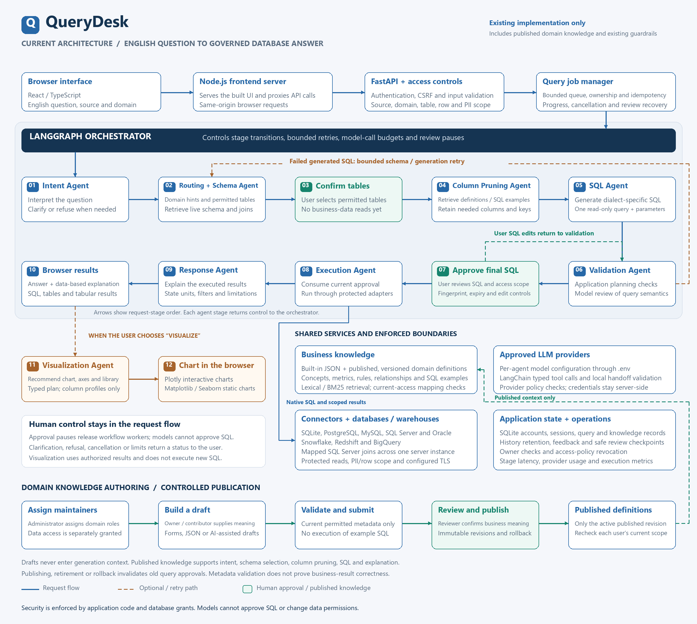

# Domain knowledge workspace

QueryDesk provides a source-specific workspace where each organization supplies and maintains its own business meaning. The project does not need prewritten Finance, HR or Supply Chain definitions. Administrators connect sources/create domains and assign the appropriate business owners, contributors and reviewers.

Open **Domain knowledge** in the browser navigation and choose a permitted business domain. Existing queries, table confirmation and final SQL approval continue to work without authored knowledge.

## Current architecture

The [current architecture and request flow](ARCHITECTURE.md) shows the agents, table/SQL approval gates, protected execution and separate knowledge-publication lifecycle.



[Open the scalable SVG](docs/architecture/querydesk-current.svg)

## Quick start by role

### Administrator: prepare and assign

1. Select the intended **Data source** at the top of the app.
2. Open **Business domains**. Create a domain, or review an existing one, with its relevant tables and business description.
3. Open **Access and security** and grant the person access to the intended source/domain. Do not add PII access unless it is separately approved.
4. Open **Domain knowledge**, select that domain, and expand **Assign knowledge owners and reviewers**.
5. Choose an enabled account, select **owner** or **contributor**, and click **Save assignment**. Assign a separate **reviewer** in the same way. If a target lacks domain access, the assignment is rejected; assigning knowledge roles never fixes missing data grants automatically.

### Owner or contributor: create and submit

1. Sign in and choose the source and domain. Confirm that **Your knowledge role** is owner/contributor.
2. Click **Create definition** and select Concept, Metric, Relationship, Rule or Example.
3. Fill in the business meaning and any synonyms. Select all required permitted column mappings, including date/filter/grouping/join columns where relevant.
4. For a metric, supply **Units**, **Aggregation grain**, any **Reporting date** and **Required business filters**. For a relationship, supply the table/key pairs and declare cardinality; choose unknown when it is not established. For an example, provide reviewed read-only SQL and its parameter list.
5. Add **Representative business review questions**, then click **Save draft**.
6. Expand **Version history and review actions** on the entry. Click **Validate metadata**, resolve any errors, then click **Submit for review**.

You can instead open **Import a definition from JSON** to preview/import developer-maintained content, or **Draft suggestions with AI** to propose metadata-based entries. Both paths still require saving a draft, review and publication. AI is optional; manual authoring does not need an LLM call.

### Reviewer: check meaning and publish

1. Select the same source/domain and open the submitted entry's **Version history and review actions**.
2. Check its definition, column mappings, units, dates, filters, join assumptions and representative questions. Use normal approved analytical queries and independent known answers when result-based checks are needed.
3. Under **Publication review**, enter evidence, independent checks and limitations. Tick the business-review confirmation.
4. Click **Publish revision**, or **Request changes** if the definition is not ready.

A non-administrator reviewer cannot publish an entry they authored. For a small-team setup an administrator can author, submit and publish, but must still enter review evidence and confirmation. Publishing does not execute the saved SQL example or waive approval for future queries.

### Business user: use the knowledge

Ask a new question using the published metric name or an accepted synonym. The agents retrieve permitted published knowledge automatically; the user still confirms tables and approves final SQL. When different published definitions share an alias, the app asks for clarification unless the intended full metric name is explicit.

## Example: first metric using the retail sample

This example is for the synthetic **Retail sample → sales** domain. Organizations must confirm their own eligibility rules rather than adopt the sample as policy.

| Field | Example value |
| --- | --- |
| Definition type | Metric |
| Name | Eligible order count |
| Business definition | Count each order once, excluding cancelled orders. |
| Synonyms | eligible orders |
| Column mappings | `orders.order_id`, `orders.status`, `orders.ordered_at` |
| Units | orders |
| Aggregation grain | one order |
| Reporting date | `orders.ordered_at` |
| Required business filters | Exclude cancelled orders |
| Representative question | How many eligible orders were placed during the reporting month? |

Save, validate, submit and publish through the role-specific steps above. `knowledge.entry.example.json` provides the corresponding import template. It is draft content, not preapproved business knowledge.

## Roles are separate from data permissions

| Knowledge role | Capabilities |
| --- | --- |
| Reader | View published entries whose referenced tables and columns are currently accessible. |
| Owner / Contributor | Create/import drafts, ask for optional AI suggestions, validate metadata and submit revisions for review. |
| Reviewer | Validate submitted content, publish after explicit business review, request changes, retire or restore an earlier published revision. |
| Administrator | Assign knowledge roles and perform authoring/review actions. For a small team an administrator can publish their own submitted draft. |

Members must already have source/domain access before assignment. Knowledge assignment does not add a data grant or PII permission. A non-administrator reviewer cannot publish a definition they authored before becoming a reviewer. Assignment is per user/source/domain, not inherited from data-access groups in this initial release. Administrators can remove assignments without changing data grants.

## What owners can build

- **Concepts:** terms, aliases, meaning and relevant column mappings.
- **Metrics:** approved business calculation descriptions, required filters, units, grain and an explicitly mapped reporting date where applicable.
- **Relationships:** accepted table pairs, up to eight composite join-key pairs and declared cardinality.
- **Rules:** business reporting conventions such as date interpretation and eligibility rules.
- **SQL examples:** reviewed read-only query patterns, named parameters, declared columns and a representative question.

Definitions are business context, not executable security policy. Metric descriptions and filter text guide generation; they are not a compiled semantic model or a proof that generated SQL implements a formula. Declared cardinality is not inferred or measured by this feature. This release uses versioned application records and relationship metadata; it does not install a graph/vector database.

## Authoring and publication flow

1. An administrator creates/reviews the business domain using **Business domains** and grants members the intended data access using **Access and security**.
2. In **Domain knowledge → Assign knowledge owners and reviewers**, assign people who already have that domain access.
3. The owner chooses **Create definition**, fills in the business meaning and maps only available columns. Record representative business review questions. Save creates an immutable draft revision.
4. **Validate metadata** checks references against current permitted schema. SQL examples are planned through the protected adapter without executing business-data reads.
5. The owner submits the current draft. Drafts and submitted revisions never enter generation context.
6. The reviewer checks the business meaning and representative questions against independent expectations. Run analytical questions through the normal query/table/SQL approval flow when result-based checks are needed. Record evidence, assumptions and limitations in the publication review notes and explicitly confirm the review.
7. Publish the current submitted revision. Only that active published version becomes available to permitted requests. Publishing invalidates old access stamps/pending query approvals; new questions require fresh context and review.

Metadata validation establishes object availability and, for SQL examples, supported planning. It **does not execute an evaluation or prove business correctness**. The UI distinguishes these facts. Review notes are recorded evidence, not an automatically verified accuracy score.

Edits create a new revision while the earlier published version remains active. A reviewer can request changes, retire the active version or restore a previously published revision after renewed metadata/business review. Restore does not resume or replay SQL execution approvals. Draft payloads remain immutable; lifecycle states and the active-version pointer are audited separately.

## Configuration import

Owners/developers can paste a definition JSON object, or an object containing `content`, into **Import a definition from JSON**. The server validates a preview before opening the editor. Imported author IDs, roles, review status and approval claims are not accepted as authority. The editor creates a new draft with a server-controlled lifecycle.

See `knowledge.entry.example.json` for a synthetic retail example. Replace its mappings and business meaning with the organization's own reviewed definition. There are no downloads required for business users.

## Optional AI-assisted drafts

**Draft suggestions with AI** accepts a business goal and sends only the currently permitted domain metadata and goal to the configured schema-role model. Existing endpoint/model/classification/PII policies apply before the provider is invoked. No business rows, warehouse credentials or saved query results are supplied.

Suggestions are limited to concepts, metrics and rules. They are validated against current mappings, never automatically saved, and never automatically published. Suggested business rules can be wrong: the owner must resolve assumptions. Manual authoring/import remain available when AI is unavailable or unapproved. Model requests may incur provider charges.

Suggestion admission is bounded to two concurrent calls per API process and six attempts per user per 15-minute throttle window. Metadata input is capped at 32 KB before calling the provider; model time/token settings still apply. This does not introduce distributed workers.

## Runtime guardrails and integration

- The existing source adapter remains authoritative for live physical metadata and query dialect.
- Published definitions are rechecked against each requesting user's current domain, table and column scope before entering context. Entries with unavailable/hidden mappings are omitted in full rather than partially exposing their definitions.
- Overlapping aliases on different published metrics trigger clarification unless the intended full metric name is explicit.

The logical context reaches intent interpretation and schema selection. Metrics, relationships and examples also support column pruning, SQL generation and validation.
- Approved examples are replanned by normal retrieval before they enter SQL-generation context. Publication does not execute them.
- Knowledge cannot modify row policies, allow hidden PII, change provider approval, expand source permissions or bypass the final user SQL approval.
- Publication/retirement/rollback atomically advances the security epoch with the version change. Old query access stamps become invalid; waiting jobs are cancelled through the existing manager.
- Current requests retain their protected execution view and normal permission rechecks. Cached or saved approvals are not publication capabilities.
- SQL edits remain supported and must pass the existing revalidation/approval flow. Automatic learning from edits/feedback remains deferred.

The mechanism uses the common metadata/planning adapter interface, so it applies to configured external databases as well as local samples. Runtime correctness, grants and transport must still be verified against each operator's actual warehouse.

## Persistence and limits

Knowledge uses additive `dk_*` tables in the existing application records database: assignments, entry heads, immutable version payloads and review events. It does not modify connected warehouse tables or existing grants. When configured local encryption is enabled, definition payloads and review-note payloads are sealed with the existing cipher; initialization also seals prior plaintext knowledge payloads. Source/domain identifiers and lifecycle metadata remain database metadata.

Knowledge is durable business configuration, separate from expiring query history. Clearing saved questions does not delete definitions or review records. Protect and retain application-database backups according to company policy. This initial release supports retirement rather than a destructive history-purge UI.

The directory loads only the selected domain’s current draft/published heads. Version histories load per entry on demand; generation reads active published versions only.

Limits: 200 entries per source/domain, 50 revisions per entry, 24 KB per definition, 30 mapped tables and 100 explicitly mapped columns per table, five review questions and 20 aliases per entry. The workspace is intended for curated business knowledge, not bulk document ingestion. Never paste customer/employee records, secrets or personal values. Local heuristic checks reject common credential/contact patterns but are not a complete personal-data classifier.

## API surface

All routes inherit session authentication, same-origin restrictions and POST CSRF checks:

```text
GET  /api/sources/{source}/knowledge?domain={domain}
GET  /api/sources/{source}/knowledge/{domain}/{id}/history
POST /api/sources/{source}/knowledge/assignments
POST /api/sources/{source}/knowledge/preview
POST /api/sources/{source}/knowledge/entries
POST /api/sources/{source}/knowledge/{domain}/{id}/review
POST /api/sources/{source}/knowledge/suggest
```

Review actions: `validate`, `submit`, `publish`, `reject`, `retire`, `rollback`. Revision checks reject stale saves. Publishing requires a representative question, reviewer authority, explicit business-review confirmation and review notes.

## Verification

Backend tests cover authentication/CSRF, separate maintenance assignments, unchanged data grants, author/reviewer separation, hidden PII and stale mappings, immutable revisions, stale saves, publication revocation, retirement/restore, metadata-only SQL planning, safe import preview, AI metadata-only drafts and configured encryption. Frontend tests cover reader/owner views, saving drafts, explicit publication review, AI suggestions and previewed imports. The browser acceptance scenario creates, validates, submits and publishes a synthetic definition through the real API/UI, without a live model call.

## Troubleshooting the workspace

| Symptom | What to check |
| --- | --- |
| Domain knowledge menu is missing | Confirm the app is launched from the updated project, restart its backend, rebuild the frontend if needed and refresh the browser. |
| Domain is missing | Check the selected source, whether the domain exists, and the account's current data grants. |
| Create definition is missing | The person may be a reader or reviewer; an administrator must assign owner/contributor authority. |
| Assignment is rejected | The account must be enabled and already have access to the source/domain. |
| A column cannot be selected or validation rejects it | Check current table membership, PII/column restrictions and whether the actual schema changed. Knowledge cannot override those controls. |
| Publish is missing or disabled | Submit the current draft first; use a reviewer/admin account, record evidence and tick confirmation. An ordinary reviewer cannot publish their own authored revision. |
| Representative questions are required | Add the questions in a new revision, save it and submit that revision. |
| Revision changed | Another revision was saved. Reload before editing again; do not overwrite a stale version. |
| Knowledge does not influence a question | Confirm it is actively published, the requesting user can access all referenced columns, and the question uses the relevant name/alias. Stale/unauthorized mappings are omitted. |
| An old query approval no longer works | Publication, retirement, restore or policy changes may invalidate old access stamps. Submit a fresh question and review the new plan. |
| AI suggestions fail | Check configured schema-role model/provider approval and quota. Metadata and concurrency limits also apply. Manual authoring/import still work. |
| Definitions remain after clearing questions | Knowledge is durable configuration with separate lifecycle/backup handling; query-history deletion does not remove it. |
