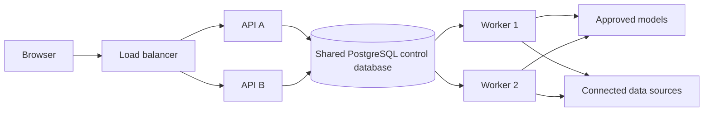

# Feasibility: durable job coordination

Status: **assessment and proposed design, not implemented**. The supported deployment remains one API process. No runtime configuration, active database or credentials were changed for this assessment.

Roadmap disposition: **planned enhancement; implementation deferred** at the user's request. See [the backlog entry](ROADMAP.md#planned-enhancement-durable-job-coordination). No implementation date is assigned.

## Decision

Feasible, with a substantial control-plane refactor. Retain the LangGraph agents and browser review flow. Introduce **PostgreSQL for shared application state and a transactional job queue**, with separate API and worker processes. Preserve SQLite/local execution as the default for existing installations.

This is an architectural recommendation, not a benchmark result. PostgreSQL documents `FOR UPDATE SKIP LOCKED` for multiple consumers of queue-like tables. Correct claims still require state transitions, leases, fencing, quotas and recovery rules. [PostgreSQL locking documentation](https://www.postgresql.org/docs/current/sql-select.html).

## What can be reused

| Existing foundation | Distributed change needed |
| --- | --- |
| `LangGraphWorkflow.advance()` and review checkpoints | Execute each bounded segment under a durable ownership claim |
| Owner-scoped submission idempotency | Shared registration/enqueue transaction and original expiry semantics |
| Review versions, deadlines and plan fingerprints | Atomic decision acceptance across API instances |
| Local single-use execution tickets | Add a durable execution gate; retain local tickets as defense in depth |
| Access stamps, row/PII checks and cancellation callbacks | Shared revocation/configuration state and owner-directed cancellation |
| Fixed budgets, retention and late-result suppression | Durable budget reservations and revision/epoch-checked writes |
| Admin operational metrics | Shared queue/lease gauges and centrally aggregated process metrics |

## Current blockers confirmed in code

1. `QueryJobs.jobs`, continuations, locks, driver handles, executor and capacity counts are process-local.
2. `QueryJobs.public()` can classify an active persisted job missing from its own memory as interrupted and update it. A cache miss must not imply that a worker died.
3. `ReviewStore.save_query()` checks lifecycle/expiry but has no worker lease, fencing epoch or expected-revision condition. A late worker can overwrite newer state.
4. `ApprovalRegistry` is in memory. Durable checkpoints deliberately omit executable accepted decisions; distributed approval handoff needs an explicit trusted protocol.
5. Initial durable registration stores a placeholder instead of the unreviewed question. That supports retry protection but cannot supply another process with its original work input.
6. `SecurityStore` uses the SQLite records file. Accounts, sessions, grants, domains and revocation state must also be shared; migrating only jobs is insufficient.
7. Policy signatures include the sample's absolute path and configuration. Different replica paths/configuration must not repeatedly invalidate a shared security epoch.

### Reproduction performed

Two independent managers used the same temporary records database with synthetic work. Manager B classified A's active job as `failed`, while A still considered it running. Both managers configured for one runnable job admitted work, giving two runnable jobs in total. No provider or warehouse calls were made.

Therefore, shared SQLite files, sticky sessions and simply increasing API worker processes do not resolve the current coordination problem.

## Proposed architecture

API instances authenticate, validate submissions, accept reviews/cancellation and read authoritative shared state. Workers claim bounded workflow segments. Human review waits hold no worker lease. The control database does not replace connected warehouses.

Proposed records include jobs/revisions, runnable segments, worker leases/epochs, authenticated review decisions, execution attempts, budget reservations, submission bindings, events/results, and shared accounts/sessions/grants/domains. Preserve exact-number encoding, encryption identities, original deadlines and deletion protection. This is a logical model, not an implemented migration schema.

## Worker ownership

1. Claim eligible work in a short database transaction using row locking, assign a worker identity, increment its fencing epoch and set a database-clock lease expiry.
2. Commit before external work; never keep a claim transaction open across model or warehouse calls.
3. Renew through an independent heartbeat path while calls block. A five-second heartbeat/thirty-second lease is a possible test starting point, not a production default.
4. Accept progress/results only if owner, epoch, expected revision, lease, access, cancellation, deletion and expiry conditions still match.
5. Stop further dispatch on ownership loss. Old workers cannot publish results or acquire another execution gate.

Heartbeats must not extend review/query/history deadlines. Use database time for distributed leases; local monotonic clocks remain suitable for local durations. Shared capacity allocations must enforce global/user/source/provider limits atomically. `SKIP LOCKED` alone does not enforce quotas or strict FIFO fairness.

## Approval and uncertain execution

**Fencing shared state cannot stop SQL already sent to a warehouse.** A worker can start SQL and then lose connectivity before saving completion. Neither a broker nor a lease proves whether the read happened.

The first distributed release should:

- Persist a trusted, authenticated, short-lived review decision separately from untrusted graph checkpoints. Bind it to actor/access stamp, job/proposal revision, effective SQL/values/scope fingerprint, configuration version and original deadline.
- Revalidate the plan/access, then atomically consume the decision and record an immutable execution-attempt marker under the current lease/epoch. Only afterward call the adapter with its local execution ticket.
- Treat ownership loss after that marker as **execution uncertain**, including a crash before the actual warehouse call. Do not automatically dispatch a second execution.
- Record native query/session IDs where adapters support them. Native reconciliation/cancellation needs connector-specific implementation, grants and live tests.
- Require fresh approval for recovered SQL reviews. A consumed decision must never become reusable. A checkpoint alone must never authorize a read.

This explicitly changes the current rule that accepted decisions are not persisted as executable authority. The authorization ledger needs security review; serializing the existing continuation dictionary is insufficient.

| Phase at worker loss | Conservative first-release recovery |
| --- | --- |
| Queued, never dispatched | Another worker may claim the durable segment |
| Waiting for review | Remain waiting; any API may serve/accept the current review atomically |
| Running planning/model segment | Mark interrupted or return to a safe checkpoint; automatic retries are opt-in and budgeted |
| Approved SQL without execution marker | Revalidate and require renewed approval on ownership-loss recovery |
| Execution marked/submission uncertain | Quarantine and reconcile; no automatic SQL replay |
| Result durably completed | Serve with current access/retention checks; do not re-execute |

Model retries can also duplicate provider charges. Reserve model/SQL attempt budgets before dispatch, retain reservations after ambiguous failures, and never reset budgets merely because a new worker claims work.

## Security, input and cancellation prerequisites

Workers need an encrypted durable input envelope; the current placeholder-only initial record cannot supply the original question. Define local preflight checks before admission or a narrowly scoped encrypted pending-input policy, with blocked-content scrubbing and short retention. Queue notifications should contain record identities, not raw questions, SQL, credentials or cells.

All replicas need shared sessions/revocation/grants, compatible encryption keys/key versions, and consistent source/knowledge/model/PII/row-policy versions. Fail closed if a required policy version is unavailable. Credentials remain in approved replica configuration or secret storage. Local source files need an explicit shared-data strategy; identical path strings do not prove identical data.

Persist cancellation intent so any API can accept it. The current worker observes it through reliable polling, optionally accelerated by notifications, invokes its local driver callback and stops later stages. Track request, acknowledgement and remote outcome separately. Crashed owners and unsupported drivers can leave remote work uncertain. Cancellation/deletion/expiry must fence late writes across every ownership epoch.

## Queue technology choice

| Option | Assessment |
| --- | --- |
| PostgreSQL state and queue | Recommended first: submission/review/enqueue share transactions, reducing cross-service handoff failure cases. Requires careful leases, indexes, backoff, quotas and recovery logic. |
| PostgreSQL state plus Celery/broker | Feasible with existing infrastructure or later measured need. Requires the same application safety controls and an atomic handoff such as a transactional outbox. Avoid blanket redelivery of warehouse execution tasks. |
| Existing SQLite and executors | Preserve local mode; insufficient for the proposed multi-host deployment. |

Celery documents acknowledgement/redelivery behavior and the need for application task idempotence. Adding a task framework alone does not resolve uncertain warehouse completion. [Celery task documentation](https://docs.celeryq.dev/en/stable/userguide/tasks.html).

## Implementation order

1. Extract job/review/security repository contracts and expected-revision transitions, preserving current SQLite behavior and tests.
2. Implement PostgreSQL application-state migrations, shared security/domain state, transactional idempotency/admission/enqueue and encrypted input handling. Define migration, backup and rollback procedures.
3. Add a worker entry point, atomic claims, heartbeats, fencing, durable budgets and graceful draining. Start with one API plus multiple workers.
4. Implement atomic review decisions, execution gates, uncertain-attempt quarantine and cancellation routing. Replace cache-miss restart inference.
5. Enable multiple API instances only after cross-instance session, ownership, policy and failover tests pass.
6. Add global lease/queue/uncertain-attempt visibility, central metrics and recovery runbooks. Evaluate broker adoption against measured demand.

## Release gates

Use real PostgreSQL and separate OS processes, not only threads/SQLite emulation:

- Two APIs submit the same key: one durable job/eligible segment; global limits remain enforced.
- Two workers claim one segment: one valid owner; stale-owner state/result writes are rejected.
- Submit through A, then poll/approve/edit/cancel through B without false interruption or ownership bypass.
- Kill workers before dispatch, during planning, after approval consumption, around native SQL submission and after result persistence.
- Lose the control database: no new reads without a valid lease/gate; uncertain execution is not reassigned.
- Race cancel/delete/expiry/access revocation with blocked work; no result resurrection or disclosure.
- Duplicate approvals/messages, retry storms and quota reservations preserve deadlines and budgets.
- Configuration/key mismatch, rotation, restore and rolling upgrades preserve fail-closed behavior.

Feasibility is high. Main risks are shared authorization/security state, durable private input and ambiguous external execution. This assessment establishes no throughput/availability target or implementation-time estimate. Keep multiple API instances disabled until these gates pass.
