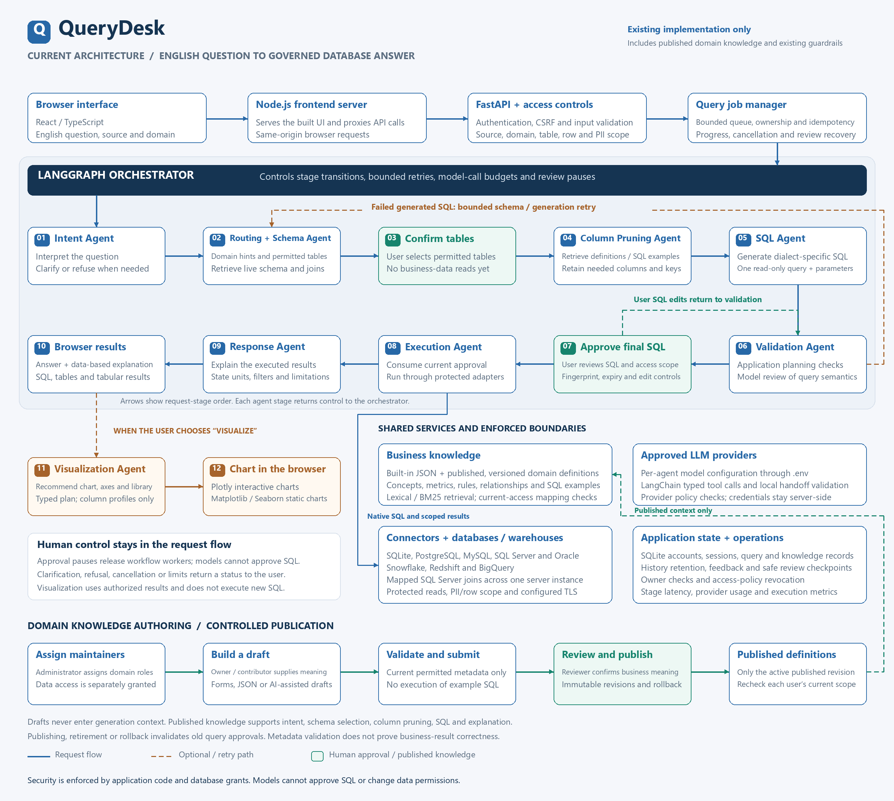

# Standalone LangChain and LangGraph NLQ to SQL

See [Current architecture and request flow](ARCHITECTURE.md) for the implemented application and [Domain knowledge quick start](DOMAIN_KNOWLEDGE.md#quick-start-by-role) for administrator, owner and reviewer instructions.



[Scalable architecture SVG](docs/architecture/querydesk-current.svg)


The [domain knowledge workspace](DOMAIN_KNOWLEDGE.md) lets assigned business owners build source/domain-specific concepts, metrics, relationships, rules and SQL examples. Drafts require review before publication; knowledge roles never grant data access.

The [synthetic analytics lab](ANALYTICS_LAB.md) adds 399,408 rows across 20 tables, two related database files, a ready-to-query local mirror and SQL Server seed/mapping files for native cross-database testing. It includes 46 months of trends, KPI definitions, customer features, outcome labels and baseline forecasts.

[Result visualizations](VISUALIZATIONS.md) add an optional agent that selects an appropriate chart and allowed Python library. Plotly renders interactive browser charts; Matplotlib/Seaborn provide inline static charts. Unsuitable results get query-improvement suggestions without automatic SQL execution.

See the [durable coordination feasibility assessment](DURABLE_COORDINATION_FEASIBILITY.md) before planning multiple API instances; the current deployment remains single-process.

The [operations and reliability guide](OPERATIONS_AND_RELIABILITY.md) covers the admin metrics screen, durable submission idempotency and isolated concurrent-user/failure exercises.

For common failures, diagnostic commands, logs and recovery steps, start with the [troubleshooting guide](TROUBLESHOOTING.md).

The [multiple-provider policy example](MODEL_POLICY_EXAMPLES.md) includes Groq, OpenAI, Claude and Gemini profiles, all unapproved until reviewed.

See [Models, capacity, editing and cancellation](QUERY_CONTROLS.md) for per-agent environment settings, cost budgets, queue limits and the Stop/Edit workflow.

This is the project's sole implementation. All agents, model integration, configuration, database access, authorization, sample data and tests are implemented here. You can move this folder to another location, recreate its virtual environment and run it there.

The UI, evaluation persistence, held-out question bank, table confirmation/feedback, source adapters, authentication and group/PII permissions are implemented. See [ROADMAP.md](ROADMAP.md) for remaining work and [PROS_AND_CONS.md](PROS_AND_CONS.md) for a balanced assessment of strengths, limitations and suitable use cases.

The active configuration is `langgraph_impl/.env`. Configuration lives alongside `.venv`, not inside it, so rebuilding the environment does not remove credentials. Secrets are ignored by Git and are not included as package data.

The first hardening increment adds saved-history retention/deletion, exact decimals and mandatory model data policy. Read [PHASE_A.md](PHASE_A.md) before upgrading. The local `model_policy.json` starts with provider approval disabled; model-backed requests require explicit operator review and approval of the endpoint/model/source profile. API keys remain in `.env`.

The browser UI is implemented with FastAPI and a Node.js/React frontend. It displays the answer, a data-based reason, selected tables, executed SQL and a native **Query results** table, without downloads. Result tables support horizontal scrolling, exact decimals/large integers, explicit NULLs and notices for empty, clipped or unretained results. See [UI.md](UI.md) for setup and startup, and the [eight-table sample report](DATASET.md#example-questions) for a complex question to try.

Browser queries require [final SQL approval](SQL_APPROVAL.md) after metadata-only planning and model review. Table confirmation alone does not permit execution. [Non-blocking reviews](NON_BLOCKING_REVIEWS.md) release workflow workers while users decide. [Restart recovery](RESTART_RECOVERY.md) restores safe review checkpoints with renewed approval; running segments and uncertain executions are never automatically replayed.

[Configurable row-level security](ROW_SECURITY.md) now supports per-source table rules and inherited group/user attributes for regions, countries, tenants and similar scopes. `ROW_SECURITY_ENABLED=false` preserves existing access until the operator reviews the local mappings and enables it. JSON policy edits reload and invalidate old approvals. See the guide for connected-source setup and connector verification limits.

[Direct protected SQLite reads](DIRECT_READS.md) now avoid business-row copying for supported non-PII queries while preserving row/column restrictions and final approval. Queries referencing classified PII retain bounded local handling. [CONNECTOR_CONTRACT.md](CONNECTOR_CONTRACT.md) defines the common governance/capability boundary for future database adapters.

[Selective local PII copying](COPY_REDUCTION.md) further limits transfers to referenced tables, required columns/decryption keys and eligible source-filtered rows. The UI shows this copy scope before approval. Complex joins and encrypted predicates remain local; transfer limits still apply.

[Bounded encrypted PII handling](BOUNDED_PII.md) adds configurable input/cell/decryption/time limits alongside the existing row/plaintext-copy ceilings. Effective limits appear in SQL approval; a limit failure ends the attempt without partial results.

## Run

From this directory:

```powershell
.\setup.ps1
.\run.ps1 "How many orders are there?" --json
.\run.ps1 "Show successful payment totals by customer in INR." --json
.\run.ps1 "Which suppliers supply each product?" --json
.\run.ps1 --schema
.\run.ps1 --graph
```

The sample has been expanded to **19 tables and 25 orders**. See [DATASET.md](DATASET.md) for relationships, metric definitions, edge cases, verified totals and example questions. Existing original sample databases can be upgraded with `.\run.ps1 --expand-demo`; existing rows are preserved and repeated upgrades do not duplicate data.

Business definitions, approved SQL retrieval, workspace routing, column pruning and a repeated golden-question evaluator are implemented. See [ENHANCEMENTS.md](ENHANCEMENTS.md) for their design, assets, commands and limits.

From the original workspace root, use `.\langgraph_impl\run.ps1` instead. The launcher always runs from this application's directory with its own `.venv`.

Setup installs the pinned dependency lock, installs this application into its own environment, creates a local `.env` from the local example if missing, and creates the local sample database if missing. It never reads or copies parent files. Python 3.11+ and internet access for dependency installation are required.

`requirements.txt` contains the complete server dependency list, including all registered database/warehouse drivers and TLS libraries. `requirements-lock.txt` records their tested versions, and package installation reads the same main list through `pyproject.toml`. To install directly, run `.\.venv\Scripts\python.exe -m pip install -r requirements.txt`. Frontend libraries are recorded in `web/package.json` and `web/package-lock.json`; `setup-ui.ps1` installs both server and frontend dependencies.

If you move this directory, recreate `.venv` at the new location and run `setup.ps1`; virtual environments themselves are not portable. The source, `.env`, SQL seed and optional local database can move together. Once installed, you can also run:

```powershell
.\.venv\Scripts\python.exe -m langgraph_impl "How many orders are there?" --json
.\.venv\Scripts\langgraph-nlq.exe "How many orders are there?"
```

## Local configuration

Edit this directory's `.env`. For Groq, either use:

```dotenv
GROQ_MODEL=openai/gpt-oss-20b
GROQ_API_KEY=your-groq-api-key
```

or the generic variables:

```dotenv
LLM_ENDPOINT=https://api.groq.com/openai/v1/chat/completions
LLM_API_KEY=your-groq-api-key
LLM_MODEL=openai/gpt-oss-20b
LLM_API_STYLE=chat_completions
LLM_STRICT_TOOLS=false
LLM_MAX_TOKENS=4000
LLM_TIMEOUT_SECONDS=90
```

Process environment overrides matching file settings. Agent-specific `LLM_<ROLE>_MODEL` values take precedence over UI model preferences and CLI `--model`; that preference is the fallback for agents without a model override. Shared generic `LLM_*` values take precedence over Groq/OpenAI aliases. `NLQ_ENV_FILE` can explicitly select a different configuration file; there is no parent-directory search. Values are loaded without shell execution or variable interpolation.

Follow [Configure different models for different agents](AGENT_MODEL_CONFIGURATION.md) to assign models to Intent, Schema, Columns, SQL, Validation and Response agents. The guide includes a complete shared-provider `.env`, matching policy JSON, supported variables, cost budgets, restart steps and a local policy/configuration check. Separate providers can be assigned to different agents using the [multiple-provider examples](MODEL_POLICY_EXAMPLES.md).

`LLM_BASE_URL` / `OPENAI_BASE_URL` are accepted when `LLM_ENDPOINT` is absent. Full `/chat/completions` or `/responses` endpoints are converted to the base URL expected by `ChatOpenAI`. `LLM_API_STYLE` selects Chat Completions or Responses and must match an explicit endpoint suffix. Set `LLM_SEND_PARALLEL_TOOL_CALLS=false` to omit that optional provider parameter. Output token budgeting uses LangChain's `max_tokens` mapping; the old custom adapter's `LLM_TOKEN_LIMIT_FIELD` setting is not used by this independent model integration.

Providers must implement OpenAI-compatible function calling and bearer authentication. Native APIs with different contracts require their own LangChain integration. No model/provider fallback occurs silently. LangChain handles HTTP requests and API-format conversion.

## Architecture

**Central orchestrator → Intent → Workspace → Schema → Examples / Columns → SQL → Validation → Execution → Response.** Every specialist returns to the orchestrator node before the next handoff.

| Local module | Responsibility |
| --- | --- |
| `workflow.py` | LangGraph state, nodes, conditional routing, retry loops and final output |
| `agents.py` | Model specialists, their role instructions and a deterministic execution worker |
| `models.py` | LangChain `ChatOpenAI`, bound output tools and normalized handoffs |
| `contracts.py` | Pydantic handoff schemas, immutable queries, budgets and single-use approvals |
| `storage.py` | Read-only SQLite connections, metadata retrieval, authorization and query limits |
| `config.py` | This application's local dotenv settings and provider configuration |
| `knowledge.py`, `knowledge/*.json` | Business metrics, relationships, workspaces, approved examples and golden cases |
| `pruning.py` | Key/metric/example preservation and recovery of actual SQL read columns |
| `evaluation.py` | Repeated generated-result comparison and JSON reports |
| `api.py`, `web/` | Authenticated FastAPI service and browser UI |
| `auth.py`, `access.py` | Accounts, sessions, inherited grants and request-scoped data views |
| `pii.py`, `pii_migrate.py` | Local encryption policy and explicit SQLite migration |
| `sources.py`, `warehouse.py`, `bigquery_source.py`, `connector_config.py`, `sqlserver_multi.py` | Registered source profiles, remote SQL adapters, native BigQuery jobs and connection controls |
| `persistence.py`, `checkpoint.py` | Application records and atomic evaluation checkpoints |
| `demo.py`, `seed.sql` | Independent sample database creation |
| `__main__.py` | Query, schema, diagram and initialization commands |
| `pyproject.toml` | Independent package installation and CLI entry point |

For the UI, authenticated domain grants first restrict the accessible catalog; the selected domain then acts as a relevance hint within that permission boundary. The CLI's explicit `--workspace` restriction retains its earlier behavior. Relevant definitions and reviewed examples ground SQL generation. Column pruning retains required columns. Six model calls normally complete an answer: intent, schema selection, column pruning, SQL generation, semantic validation and response generation. Orchestration, routing, retrieval, metadata access and execution use deterministic code.

Validation rejection or execution errors route back through schema selection and SQL generation for a fresh review. Defaults are three SQL attempts, 40 model calls overall and three local contract-repair calls per role invocation. The graph also has a recursion limit. All request state and approvals are recreated for each `ask()`.

See [graph.mmd](graph.mmd) for the compiled graph. Implementation uses the official [LangGraph Graph API](https://docs.langchain.com/oss/python/langgraph/graph-api) and [ChatOpenAI tool binding](https://reference.langchain.com/python/langchain-openai/chat_models/base/ChatOpenAI).

## Authentication and PII

The first browser setup requires an `AUTH_SETUP_TOKEN` configured in `.env`; see [SECURITY.md](SECURITY.md). Other users self-onboard to one domain; administrators manage additional grants, groups and PII access. Standard groups support inherited domain grants and PII allow/deny policies. PII columns are removed before unauthorized queries run. Optional AES-GCM encryption is controlled by `.env` and `encryption.json`; local column migration is explicit and offline. Region/country row filters are configurable per source and remain disabled in the example configuration until mapped and enabled by the operator; see [ROW_SECURITY.md](ROW_SECURITY.md).

## Data sources and business domains

[Same-instance SQL Server cross-database joins](SQLSERVER_CROSS_DATABASE.md) now allow one source profile to register approved tables from multiple databases/schemas. Logical table IDs keep domains, PII and row rules unambiguous; final SQL approval shows the real three-part paths. Unmapped objects, linked servers and other-engine federation remain blocked. Existing profiles retain their scope.

Mapped-source table confirmation displays permitted objects as **database → schema → table**, retaining suggested selections and supporting individual/database/schema checkboxes. Users can adjust tables across registered databases before SQL generation; group selection cannot expand permissions. Ordinary sources retain their existing selector.

SQL Server/Azure SQL, Oracle, Snowflake, Amazon Redshift and Google BigQuery adapters now join SQLite, PostgreSQL and MySQL. Existing adapters also cover managed AWS RDS/Aurora and GCP Cloud SQL deployments. See [WAREHOUSE_CONNECTORS.md](WAREHOUSE_CONNECTORS.md) for server drivers, AWS/GCP identities, limits, example profiles and the distinction between local contract tests and pending live-server verification.

SQLite is the default; all registered remote connectors are included in the main requirements and support configured source selection, connection testing and dialect-aware SQL. Administrators can define domains in the UI, developers can configure them in JSON, and AI can suggest drafts for administrator review. UI domains guide relevance within the user's assigned domain union. See [SOURCES_AND_DOMAINS.md](SOURCES_AND_DOMAINS.md) for setup, scope and connector verification limits.

## Independent sample data

The default database is **this directory's `data/sales.db`**, created from the local `seed.sql` and `dataset_extension.sql`. Its 19 populated tables have primary keys and foreign-key relationships. Key totals are:

| Table | Rows |
| --- | ---: |
| customers | 12 |
| products | 10 |
| orders | 25 |
| order_items | 36 |
| suppliers | 4 |
| product_suppliers | 11 |
| warehouses | 3 |
| inventory | 30 |
| payments | 27 |
| shipments | 17 |
| added business tables | 9 |

There are 16 completed, three cancelled, three pending, two processing and one shipped order. Amounts use integer hundredths of INR. Successful payments total INR 9,125, successful refunds INR 1,630, and net collected cash INR 7,495. The dataset spans September–November 2026 and includes profiles/segments, promotions/discounts, returns/refunds, purchase orders/items and a reconciled inventory movement ledger. Aggregate independent child tables separately before joining to avoid double counting.

To create a new local database manually, use `--init-demo`. Existing files are never overwritten. `--db` explicitly selects another database when desired.

## Database controls and limits

Read-only file connections and SQLite query-only mode enforce no writes. A connection authorizer permits reads only within selected, allowed regular tables and an explicit function allowlist. Catalog access, views, virtual tables, write statements, database attachment and extension loading are denied. SQLite rejects multiple statements. Named filter values are bound separately from SQL.

The Validation Agent performs metadata-only SQL checks and asks its configured model to review semantics. SQLite planning compiles against empty permitted schemas; remote planning parses and checks scoped SQL without querying business data. Source compilation and data reads happen after approval. Execution requires a single-use approval tied to the exact SQL, parameter values and table scope. Database authorization is repeated on the execution connection. Model-generated approval flags alone cannot authorize execution.

Default limits are a three-second SQLite VM execution budget, 100 returned rows, 2,000 characters per text cell and approximately 64 KB of serialized row data. Partial/clipped results receive a runtime disclosure. These controls cannot prove business correctness or every statement in the generated answer. A progress handler does not bound all operating-system I/O or memory allocation.

The CLI runs directly; the UI requires table confirmation before SQL generation and a separate final SQL approval before protected-view materialization or query execution. Planning and example checks use metadata only. SQL execution approvals remain single-use and in-process; they are never resumed. Evaluations support durable checkpoints/resume, and completed UI queries and feedback have separate local persistence. There is no conversation memory. The API job queue, continuations and approval state are process-local: run only one API process until distributed job coordination and approval locking are implemented and tested. Sharing the SQLite application database between API processes is not sufficient. Provider requests include question text, selected metadata, SQL and bounded result data; use approved data and provider policies. No private reasoning transcripts or keys are included in application traces. See [ENHANCEMENTS.md](ENHANCEMENTS.md) for evaluation reliability, the held-out bank and feedback review, and [UI.md](UI.md) for deployment readiness.

## Verification

Documentation reviewed on 14 November 2026 against the current implementation. Earlier feature guides retain explicitly labeled historical verification counts; the latest regression results are recorded below.

From this directory:

```powershell
.\.venv\Scripts\python.exe -m unittest discover -s tests -v
.\.venv\Scripts\python.exe -m pip check
Push-Location web
npm test
npm run build
npx playwright install chromium
npm run test:e2e
npm audit
Pop-Location
```

Tests cover real graph execution and joins, SQL and execution repair, local contract validation, permission restrictions, approval binding, model budgets, truncation, isolated requests, local dotenv loading and LangChain tool binding. A relocation test copies only this application's source to a temporary folder, creates fresh sample data and completes a full offline query there. Import checks restrict application dependencies to local modules, standard Python libraries and the declared frameworks.

The Playwright browser test runs the production frontend against an isolated local API, temporary sample SQLite database and deterministic workflow; it does not use external provider credentials. It verifies administrator setup, table confirmation, SQL approval and the displayed result. It is separate from frontend component tests and does not establish live-model accuracy or multi-process safety. Held-out evaluation reports result correctness plus a strict SQL/reference match diagnostic; see [ENHANCEMENTS.md](ENHANCEMENTS.md).

Current local verification: 238 Python/API tests, 46 frontend tests, one browser E2E test, a successful production build, clean Python dependency checks and no npm audit findings. See [TEST_AND_SECURITY_REPORT.md](TEST_AND_SECURITY_REPORT.md) for the full run and security review. This does not establish live warehouse compatibility, multi-process safety or general model accuracy.
