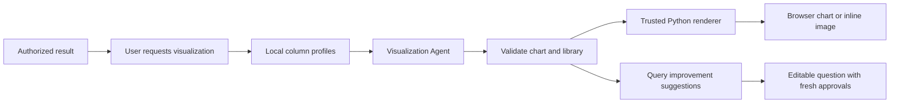

# Result visualization and the Visualization Agent

The [synthetic analytics lab](ANALYTICS_LAB.md#questions-to-try) provides 46 months of trends, regional/segment KPIs, cohort analysis and forecast comparisons for chart testing, with 399,408 rows across 20 related tables.

## User flow

1. Ask a question, confirm tables and approve SQL normally.
2. After an answered query, click **Visualize this result** below the table.
3. Leave **Chart presentation** at **Let AI choose**, or request **Interactive** / **Static**.
4. The agent recommends a chart, axes and an available Python library. The app validates these and shows the library, reason and chart.
5. Unsuitable results receive suggested grouping attributes, numeric metrics, filters or aggregation. **Use suggestion in a new question** fills the composer only. It requires the usual table/SQL approvals before execution.

The original answer/table remain visible. Visualization does not rerun SQL, reuse its old approval or silently aggregate/filter/convert units. Hide/Show reuses the received chart.

## Python preparation and browser rendering



This is an optional post-result branch using the existing specialist contracts, model policy and metrics. It adds no mandatory model call to the normal six-call query path. The primary `--graph` remains unchanged; this diagram shows the optional branch.

Plotly Python produces figure JSON; the browser renders it with the matching Plotly.js included in the installed Python package. The authenticated `/api/assets/plotly.js` endpoint serves that local asset. Hover, pan and zoom run in the browser, without a CDN or hosted chart service. See [Plotly's figure documentation](https://plotly.com/python/creating-and-updating-figures/).

Matplotlib/Seaborn render a bounded PNG in memory with the headless Agg backend; the browser displays it inline. These outputs have no point-hover/zoom. KPI cards show exact numeric text directly. End users install nothing; no chart file download is required. Export/cloud buttons are removed, the same-origin security policy remains intact, and no extra npm chart package is needed.

## Library selection

The LLM chooses only from installed, operator-allowed adapters advertised by the server. It cannot install/import arbitrary packages, generate plotting code or supply unrestricted chart/HTML specifications. The UI shows its choice and rationale; this is a recommendation, not proof of business correctness.

| Library | Role | Status |
| --- | --- | --- |
| [Plotly](https://github.com/plotly/plotly.py) | Interactive charts | Implemented: bar, time-series line, scatter, KPI |
| [Matplotlib](https://matplotlib.org/) | Static charts | Implemented: bar, time-series line, scatter, KPI |
| [Seaborn](https://seaborn.pydata.org/) | Static statistical presentation | Implemented: bar, scatter, KPI; no line adapter |
| [Bokeh](https://docs.bokeh.org/en/latest/) | Interactive browser visualizations | Future adapter, including local browser assets |
| [Altair](https://altair-viz.github.io/) | Declarative Vega-Lite charts | Future adapter with constrained specs/local rendering |
| [Plotnine](https://plotnine.org/) | Grammar-of-graphics figures | Future static adapter |
| [Folium](https://python-visualization.github.io/folium/) | Geographic browser maps | Future adapter; needs geographic fields and approved tiles/data access |
| [Cartopy](https://scitools.org.uk/cartopy/docs/latest/) | Cartographic figures | Future adapter with reviewed/offline map datasets |
| [missingno](https://github.com/ResidentMario/missingno) | Missing-data diagnostics | Future adapter over returned authorized rows, not the entire database |

The renderer boundary is `PlotlyRenderer` / `StaticRenderer` in `visualization.py`. New libraries need an adapter, capabilities, typed validation, output support, dependencies and tests. Installing a package or listing its name in `.env` does not implement it.

## Data requirements and limits

| Chart | Required result |
| --- | --- |
| Bar | Unique category/date groups and one numeric metric; 2–30 complete points |
| Line | Unique ISO date/time and one numeric metric; at least two complete points, at most 200 points |
| Scatter | Two different numeric metrics; 2–500 complete points |
| KPI | One row and a numeric metric |

Planning accepts at most 64 columns, 1,000 rows and 256 KiB of serialized result data. Figure/image payloads are bounded too. Repeated groups require explicit aggregation in a new query. No automatic top-N selection occurs. Truncation/clipping of the underlying query is disclosed.

NULL metrics are not made zero. Bar/scatter omit incomplete coordinates with a notice; lines preserve metric gaps. Lines are ordered by timestamp; naive dates are treated as UTC for ordering and static time axes show UTC. Numeric-looking strings are not silently cast; identifier-like names such as `customer_id`/phone are not metrics. These are conservative heuristics, not business-semantic guarantees.

Geometry uses floating-point coordinates. Unsafe high-precision/large plotted metrics are rejected; the table retains exact values. KPI values remain exact text and Plotly tooltips use original displayed values. Static axis labels can be shortened with a notice. Charts describe only returned data.

## Security, retention and cost

`POST /api/queries/{id}/visualize` requires the authenticated owner, CSRF, a completed answered job, current access stamp and live/unexpired results. The body accepts only `presentation` (`auto`, `interactive`, `static`), defaulting to `auto`; it accepts no rows or SQL. Access/liveness are rechecked before cache publication/return.

The model receives column names and local profiles (types, row/distinct/NULL counts, plotting safety), available renderers and the requested presentation. It receives no result cells, original question or SQL. Metadata still passes the source's model policy; column names/aliases can themselves be sensitive. Authorized data cells are used only for local rendering and the owner response.

Trusted code builds traces, axes and output formats. Interactive text is escaped; static output is PNG, with TeX/code execution disabled. At most two visualization requests run concurrently. Duplicate in-flight requests/saturation return HTTP 429. Matplotlib/Seaborn rendering is serialized.

Up to 50 recommendations/figures are cached in memory for at most ten minutes and never beyond query expiry. Cache reads recheck access; history deletion erases matching entries; maintenance purges expired entries. Deleted/revoked work cannot publish a late chart. Charts are not persisted with history. When saved history omits rows, a fresh reviewed query is necessary. Reloading can require a new recommendation; cached suggestions never automatically become approved SQL/examples.

## Configuration

```dotenv
# Optional; omitted role values inherit shared settings.
LLM_VISUALIZATION_MODEL=openai/gpt-oss-20b
LLM_VISUALIZATION_MAX_TOKENS=1500
LLM_VISUALIZATION_TIMEOUT_SECONDS=45
VISUALIZATION_MAX_MODEL_CALLS=3
VISUALIZATION_RENDERERS=plotly,matplotlib,seaborn
```

The role also supports `ENDPOINT`, `API_KEY`, `API_STYLE`, `STRICT_TOOLS` and `SEND_PARALLEL_TOOL_CALLS` after `LLM_VISUALIZATION_`. A separate endpoint needs its own key/model and an approved source-policy profile. Keys never belong in questions/specifications.

The separate per-request model-call budget is 1–3. A valid recommendation normally uses one call; malformed handoffs can retry within the cap. SDK transport retries remain disabled. Optional calls appear under `visualization` in Operations without changing the completed query's original call total.

The renderer environment setting is an allowlist of implemented adapters, not a package loader. Explicit interactivity/static preferences are enforced. Missing compatible adapters fail without executing SQL.

Python chart libraries and tested dependencies are included in `requirements.txt` and `requirements-lock.txt`. Use the normal setup flow to update `.venv`, rebuild the frontend, restart the backend and refresh the browser. The browser renderer comes from the Python Plotly installation, with no npm chart installation or external chart account.

## Troubleshooting and verification

- No button: wait for a completed answered query with results.
- Rows omitted from history: obtain fresh data through the normal approved query flow.
- Policy refusal: check visualization role endpoint/model approval and source classification.
- Duplicate/unsafe/overcrowded data: use suggested query improvements; the app does not silently change results.
- Static renderer unavailable: enable/install a supported static adapter or choose another presentation.
- Browser renderer unavailable: check the signed-in session, local asset endpoint, updated requirements and proxy. The table remains available.
- Capacity busy: wait and retry visualization; do not repeatedly resubmit the business question.

Tests cover renderer choice/preferences, safe Plotly JSON and real static PNGs, metadata-only model context, exact KPI values, numeric/NULL/date validation, call/cache bounds, deletion/expiry, ownership/CSRF/revocation, and policy failure. Browser E2E covers reviewed SQL, KPI, interactive Plotly bars under existing CSP, and a Seaborn image. Tests use scripted model recommendations; live model quality/remote warehouse compatibility are not certified.
